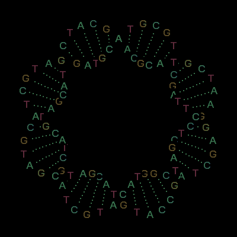

  

I build at the intersection of **AI and biology**, with a focus on **RNA regulatory biology** at Penn. I'm also exploring biosecurity, agentic systems, and how complex behavior emerges from simple rules.

[Writing ↗](https://substack.com/@evancorrea)

### Selected work

| Project | What I'm exploring |
| :--- | :--- |
| 🧬 **[POLYNET](https://github.com/evancorrea/POLYNET)** | Predicting polyadenylation sites from genomic sequence with deep learning. |
| 🔍 **[Mirage](https://github.com/evancorrea/mirage)** | Evaluating whether scientific discovery agents distinguish real signal from noise, confounding, and artifacts. |
| 🛡️ **[Lucid](https://github.com/Aarjav0210/lucid)** | Automated biosecurity screening for biological synthesis. |
| 🏆 **[Crucible](https://github.com/TheApexWu/crucible)** | Studying emergent deception between LLM agents. **1st place overall** at the Self Improving Agents Hack at Datadog. |

### Recurring interests

RNA regulation · machine learning · biosecurity · Escher · recursion · emergence

Biological sequences. Learning systems. Strange loops.

<!-- To understand recursion, see this profile. -->
